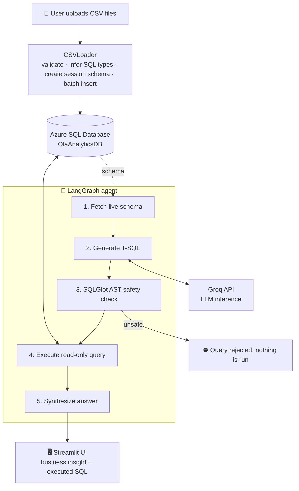

# 🚖 Ola Data Analyst — An Agentic AI-Powered SQL Analyst

> Ask business questions in plain English. Get safe, read-only T-SQL, real results from Azure SQL, and a clear written insight, with the generated SQL shown for full transparency.

<p align="center">
  <a href="https://ola-data-agent.streamlit.app/"><b>🚀 Live Demo</b></a> &nbsp;·&nbsp;
  <a href="https://drive.google.com/file/d/1X0lCGmGLVySAQmslPTfQHdMiobYNwA74/view?usp=sharing"><b>📄 Resume</b></a> &nbsp;·&nbsp;
  <a href="https://www.linkedin.com/in/mohammad-raheem-400783294/"><b>💼 LinkedIn</b></a> &nbsp;·&nbsp;
  <a href="https://github.com/mohammadraheem786"><b>🐙 GitHub</b></a>
</p>

<p align="center">
  <a href="https://www.python.org/"></a>
  <a href="https://streamlit.io/"></a>
  <a href="https://langchain-ai.github.io/langgraph/"></a>
  <a href="https://azure.microsoft.com/en-in/products/azure-sql/database"></a>
  <a href="https://groq.com/"></a>
</p>

---

## 📖 Overview

**Ola Data Analyst** is an end-to-end conversational business intelligence application. It turns natural-language questions into **safe, optimized T-SQL**, runs them on **Microsoft Azure SQL Database**, and returns **human-readable analytical insights** next to the exact query that produced them.

Upload your own relational CSV files, ask questions like *"Which city has the highest average fare?"*, and the agent handles schema discovery, SQL generation, safety validation, execution, and explanation.

🔗 **Try it live:** [ola-data-agent.streamlit.app](https://ola-data-agent.streamlit.app/)

---

## ✨ Key Features

| Feature | What it does |
|---|---|
| 📁 **Multi-file CSV ingestion** | Upload several related datasets at once (`rides.csv`, `payments.csv`, `ratings.csv`, `users.csv`, `vehicles.csv`), up to **20 MB** and **100,000 rows** per file. |
| 🧬 **Automatic schema & type inference** | Scans columns and infers conservative SQL Server types (`INT`, `BIGINT`, `DECIMAL(p,s)`, `FLOAT`, `DATE`, `DATETIME2`, `NVARCHAR`), casts Python values, then batch-inserts through `pyodbc` with `fast_executemany`. |
| 🏢 **Multi-tenant workspace isolation** | Creates an isolated SQL Server schema (`[ws_<uuid>]`) per user session, so tables never collide and cross-table `JOIN`s work cleanly. |
| 🤖 **Multi-stage LangGraph agent** | Introspects the live schema → generates T-SQL with a Groq LLM → validates the query → executes it → explains the result. |
| 🛡️ **AST-based safety validation** | **SQLGlot** parses every generated query and enforces read-only `SELECT` statements within the active workspace schema. |
| 🖥️ **Three-panel Streamlit UI** | A dataset uploader with workspace status, a conversational chat interface, and a live SQL transparency panel. |

---

## 🧠 How It Works

1. **Schema introspection:** retrieves live table definitions, column data types, and relationships from the active workspace.
2. **T-SQL generation:** the Groq LLM translates the question into SQL Server syntax.
3. **AST & safety validation:** SQLGlot parses the query; anything that isn't a single read-only `SELECT` on the workspace schema is rejected before it reaches the database.
4. **Execution:** the validated query runs against Azure SQL.
5. **Synthesis:** tabular results are turned into a clear business answer, shown alongside the executed SQL.

---

## 🏗️ System Architecture



---

## 🛠️ Tech Stack

| Layer | Technologies |
|---|---|
| **Frontend / UI** | Streamlit |
| **AI orchestration** | LangGraph, LangChain |
| **LLM inference** | Groq API |
| **Database** | Microsoft SQL Server / Azure SQL Database |
| **Database driver** | PyODBC (ODBC Driver 17 / 18 for SQL Server) |
| **SQL validation & parsing** | SQLGlot, Pydantic |
| **Language & packaging** | Python 3.11+, uv / pip |

---

## 📂 Sample Dataset

The project is tested with a 5-table relational ride-hailing dataset of about **61,000 rows**:

| File | Rows | Contents |
|---|---:|---|
| `users.csv` | 10,000 | `user_id`, `first_name`, `last_name`, `email`, `phone`, `city`, `province`, `user_type`, `signup_date`, `is_active` |
| `vehicles.csv` | 3,000 | Vehicle registration, driver mapping, model, and category details |
| `rides.csv` | 20,000 | Ride transactions linking riders and drivers, with timestamps, fares, pickup/drop locations, and ride status |
| `payments.csv` | 16,073 | Payment records, methods, transaction statuses, and amounts linked to rides |
| `ratings.csv` | 12,000 | `rating_id`, `ride_id`, `rider_id`, `driver_id`, `rating` (1–5), `comment`, `rated_at` |

---

## 💬 Example Questions

- *What is the average fare by city?*
- *Which payment method is used most often?*
- *Who are the top 5 drivers by average rating?*
- *How many rides were cancelled, and what are the most common reasons?*
- *What is the total ride revenue per month?*

---

## 🚀 Getting Started (Local Setup)

### 1. Prerequisites

- Python **3.11+**
- **Microsoft ODBC Driver 17 or 18 for SQL Server** installed on your machine
- A local SQL Server instance or an **Azure SQL Database**
- A **Groq API key** from [console.groq.com](https://console.groq.com)

### 2. Clone the repository

```bash
git clone https://github.com/mohammadraheem786/ola-data-agent.git
cd ola-data-agent
```

### 3. Install dependencies

**Using uv**

```bash
uv venv
.venv\Scripts\activate          # Windows  (macOS/Linux: source .venv/bin/activate)
uv pip install -r requirements.txt
```

**Or using pip**

```bash
python -m venv .venv
.venv\Scripts\activate          # Windows  (macOS/Linux: source .venv/bin/activate)
pip install -r requirements.txt
```

### 4. Configure environment variables

Create a `.env` file in the project root:

```env
GROQ_API_KEY=your_groq_api_key_here

DB_SERVER=your_server_name.database.windows.net
DB_NAME=OlaAnalyticsDB
DB_DRIVER=ODBC Driver 18 for SQL Server
DB_USER=your_db_username
DB_PASSWORD=your_db_password

DB_ENCRYPT=yes
DB_TRUST_SERVER_CERTIFICATE=no
DB_CONNECTION_TIMEOUT=60
```

### 5. Run the application

```bash
streamlit run app.py
```

---

## ☁️ Deploying on Streamlit Community Cloud

1. Push your repository to GitHub (make sure `.env` is excluded via `.gitignore`).
2. Log in to [Streamlit Community Cloud](https://streamlit.io/cloud) and click **Create app**.
3. Select your repository, branch (`main`), and entrypoint file (`app.py`).
4. Open **Advanced settings → Secrets** and add your credentials in TOML format:

```toml
GROQ_API_KEY = "your_groq_api_key_here"
DB_SERVER = "your_server_name.database.windows.net"
DB_NAME = "OlaAnalyticsDB"
DB_DRIVER = "ODBC Driver 17 for SQL Server"
DB_USER = "your_db_username"
DB_PASSWORD = "your_db_password"
DB_ENCRYPT = "yes"
DB_TRUST_SERVER_CERTIFICATE = "no"
DB_CONNECTION_TIMEOUT = "60"
```

> **Note:** use **ODBC Driver 17 for SQL Server** on Streamlit Cloud's Linux containers.

5. In your Azure SQL Server **Networking** settings, add a firewall rule that allows incoming connections from Streamlit Community Cloud, then save.

---

## 🔒 Security & Guardrails

- **Read-only enforcement:** generated queries are parsed into an Abstract Syntax Tree with **SQLGlot**. Any `DROP`, `DELETE`, `UPDATE`, `INSERT`, `ALTER`, or `EXEC` statement is blocked before it reaches the database.
- **Schema sandboxing:** queries are restricted to the user's isolated session schema (`[ws_<uuid>]`).
- **Parameterized insertion:** all CSV records are inserted through parameterized `pyodbc` batches, with quoted SQL identifiers (`[...]`) to prevent SQL injection via malformed CSV headers or cell values.

---

## 🗂️ Project Structure

```text
ola-data-agent/
├── app.py                  # Streamlit UI
├── agents/
│   └── sql_analyst.py      # LangGraph SQL analyst agent
├── utils/
│   ├── csv_loader.py       # CSV validation, type inference, batch loading
│   └── db_conn.py          # SQL Server connection and query helpers
├── Models/
│   └── schema.py           # Pydantic state and output schemas
├── requirements.txt
└── .env                    # local secrets (not committed)
```

---

## 🎯 What This Project Demonstrates

- **Data engineering:** CSV validation, automatic type inference, and high-speed batch loading into SQL Server.
- **Agentic AI:** a multi-step LangGraph workflow with an LLM that writes SQL and explains results.
- **Secure text-to-SQL:** AST-level validation and per-session schema isolation instead of trusting model output.
- **Applied SQL:** T-SQL generation across related tables, including joins and aggregations.
- **Deployment:** a live Streamlit app connected to Azure SQL.

---

## 👤 About the Author

**Mohammad Raheem**, B.Tech in Information Technology, focused on data analytics, data engineering, and AI-powered applications.

<p>
  <a href="https://www.linkedin.com/in/mohammad-raheem-400783294/"></a>
  <a href="https://github.com/mohammadraheem786"></a>
  <a href="https://drive.google.com/file/d/1X0lCGmGLVySAQmslPTfQHdMiobYNwA74/view?usp=sharing"></a>
  <a href="https://ola-data-agent.streamlit.app/"></a>
</p>

⭐ If you found this project useful, consider giving the repository a star.